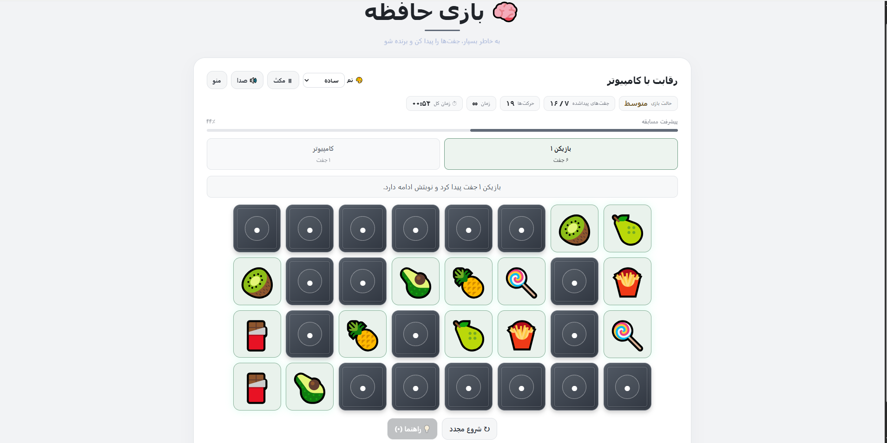

# ⚡ Memory (حافظه)


یک بازی فکری و تقویت حافظه در سبک **Memory Match / پایداری دیداری** که به صورت تک‌فایلی (`Single-File`) و بدون هیچ‌گونه فریم‌ورک یا کتابخانه جانبی پیاده‌سازی شده است.

🎮 **[اجرای آنلاین و تجربه بازی](https://iammfk.github.io/memory/)**

> ✅ **کراس‌پلتفرم و ریسپانسیو:** این بازی هم روی **دسکتاپ (Desktop)** و هم روی **موبایل و تبلت (Mobile & Tablet)** به‌صورت کامل اجرا می‌شود و چیدمان کارت‌ها و کنترل‌ها متناسب با ابعاد صفحه تغییر می‌کند.

### 🖼️ پیش‌نمایش بازی

<p align="center">
  
</p>

## 🕹️ گیم‌پلی و مکانیک‌ها

* **کمپین ۵۰ مرحله‌ای (Solo):** افزایش تدریجی کارت‌ها، چالش زمان و محدودیت تعداد حرکت در مراحل بالا همراه با رتبه‌بندی ستاره‌ها.
* **رقابت با هوش مصنوعی و چندنفره محلی:** امکان مسابقه دونفره با کامپیوتر (با حافظه مصنوعی و ۴ سطح سختی) یا بازی نوبتی با دوستان روی یک دستگاه.
* **سیستم شافل خودکار (Shuffle):** در سطح سختی خیلی سخت (Very Hard)، کارت‌های مخفی باقیمانده در پایان هر دور کامل جابه‌جا می‌شوند تا حافظه به چالش کشیده شود.
* **سیستم راهنما (Hint System):** امکان کمک گرفتن از راهنما در نوبت خود؛ دکمه راهنما به محض لمس اولین کارت غیرفعال می‌شود تا جلوی تقلب و خطای حرکتی گرفته شود.
* **۱۰ پوسته و تم گرافیکی:** شامل تم‌های کلاسیک، مدرن، مینیمال، انیمه، نئون، طبیعت، غروب، اقیانوس، آبنبات و مونو با ذخیره‌سازی تم انتخابی در مرورگر.
* **جلوه‌های صوتی پروسیجرال:** شبیه‌سازی کامل افکت‌های صوتی در لحظه با استفاده از **Web Audio API** بدون نیاز به فایل‌های صوتی خارجی.
* **رندر سبک و تمیز:** اجرای روان با CSS Grid/Flexbox بدون بار اضافی روی مرورگر.

## 🎯 حالت‌های بازی (Game Modes)

| حالت بازی | ویژگی‌ها |
| :--- | :--- |
| **سولو (Solo)** | ۵۰ مرحله متنوع، قفل‌گشایی تدریجی، چالش زمان و حرکت |
| **رقابت با هوش مصنوعی (AI)** | ۴ درجه سختی، شبیه‌سازی حافظه ربات، شافل دوره‌ای در حالت خیلی سخت |
| **چندنفره محلی (Multiplayer)** | امکان رقابت نوبتی چند بازیکن روی یک گوشی یا رایانه |

## 🎮 کنترل‌ها

### 💻 دسکتاپ (Desktop)

| عمل | کنترل |
| :--- | :--- |
| **انتخاب و برگرداندن کارت** | کلیک ماوس روی کارت |
| **راهنما و دکمه‌ها** | کلیک ماوس روی دکمه‌های مربوطه |

### 📱 موبایل و لمسی (Mobile / Touch)

| عمل | کنترل |
| :--- | :--- |
| **انتخاب کارت / تعامل** | لمس مستقیم روی کارت‌ها و دکمه‌ها |

## 🛠️ تکنولوژی‌ها

* **Vanilla JavaScript (ES6+):** موتور منطق بازی، ماشین حالت نوبت‌ها، هوش مصنوعی و انیمیشن‌ها
* **Web Audio API:** سینت‌سایزر نرم‌افزاری برای تولید افکت‌های صوتی ریل‌تایم
* **CSS3 Grid & Animations:** طراحی واکنش‌گرا و پیاده‌سازی انیمیشن‌های چرخش کارت و شافل
* **HTML5 LocalStorage:** ذخیره‌سازی ماندگار تم دیداری منتخب کاربر

## 🚀 اجرای لوکال

برای اجرای بازی نیاز به هیچ ابزار یا سروری نیست.

کافیست فایل `index.html` را در هر مرورگری اجرا کنید یا ریپازیتوری را کلون نمایید:
```bash
git clone https://github.com/IamMFK/memory.git
# سپس index.html را در مرورگر باز کنید
